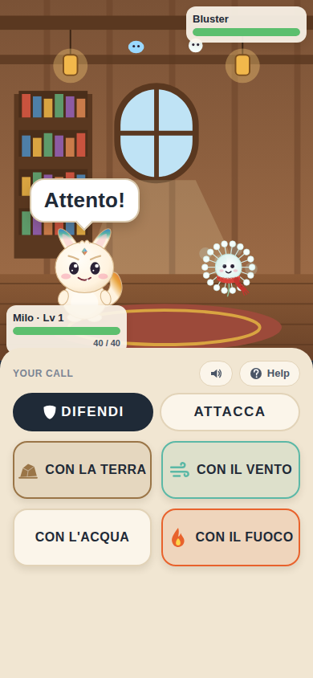
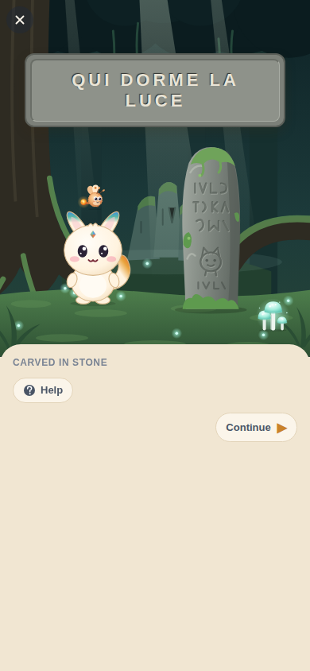
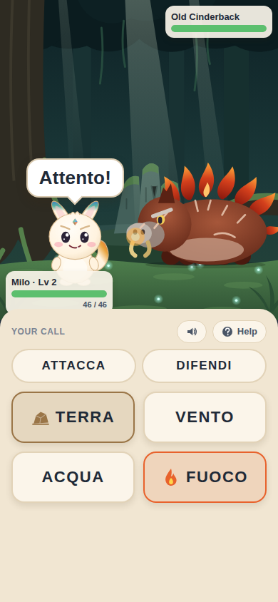

# Lexbound

An offline creature-companion RPG. In **Lexora**, humans speak English and the creatures, the **Lexlings**, speak their own language. You're a Translator-in-training, and your partner is **Milo**, a small Lexling nobody can identify who can somehow use every element. Understanding what he says is how you tell him what to do.

The Lexlings' language is real Italian. The game never says so; it just becomes the player's superpower.

<p>
  
  
  
  
</p>
<p>
  
  
  
</p>

## What's playable

Chapter One, on real engines:

1. **The Lodge.** Maren, a basket, a Lexling who says "Ciao!".
2. **The first night.** Milo is starving: "Fame..." He eats, then looks at the stars and says something nobody can follow yet.
3. **Whisperwood.** "Guarda!" and he points; "Vieni!" and he runs ahead.
4. **The stream.** Milo splashes and says "Acqua!". No translation anywhere.
5. **A hungry Pebblit.** A wild Lexling says "Ho fame...", and you realise it's Milo's word.
6. **The hot path.** Milo asks for "Acqua..."; the stick doesn't help, the flask does.
7. **The Emberhog.** It shouts before every move. ACQUA puts out "Fuoco!"; TERRA walls off "All'attacco!". By now ACQUA has lost its icon; the words you haven't used still have theirs. Listen, and nothing lands on Milo.
8. **After.** The Emberhog says something to Milo you can't follow yet. Two Puffkins whisper about him. Milo acts out the fight at camp. At the Lodge, Pip insists his Puffkin is restless; you can hear it's hungry.

Then Whisperwood keeps going: repeatable encounters picked by a scheduler that brings back the words you're losing, in new situations and from new voices.

Chapter Two, the Old Hollow:

1. **Milo's game.** He knocks pinecones off a log, announcing every shot: "Attacco con l'acqua!", "Mi difendo con la terra!". From now on you can tell him how, not just what: DIFENDI + CON LA TERRA.
2. **A spar with Bluster.** "Vento grande!" means a gale no attack can stop. A wall can.
3. **The Old Hollow.** "Aspetta!", a step before the ground gives way. A Flickerwing too scared to glow: "Non ho fame... ho paura." Words carved in a standing stone, and under them, MILO.
4. **The Craglings' plan.** Keep listening behind the rocks and you'll know how they mean to fight.
5. **Old Cinderback.** "Ora... il fuoco grande!" Shield it, or lose.
6. **After.** Milo says something at camp you understand completely. Maren holds the rubbing next to the tag from his basket.

Camp, map, Milo's page, a journal (story, field notes, a bestiary with remembered lines, strange things heard or found carved), a bag, accessibility settings and developer tools come with it.

## Run it

Node 22.

```bash
npm install
npm run app          # Expo dev server: press i / a for a simulator, or scan with Expo Go
npm run web          # in a browser
```

## Check it

```bash
npm run check        # typecheck, lint, copy lint, unit + content tests, sound files up to date
npm run e2e          # builds for web and plays chapters one and two in Chromium
npm run screens      # the same, saving screenshots to ./screens
```

## Layout

| Folder | What |
| --- | --- |
| `packages/core` | The engines: language model, encounters, battles, scheduler, progression, save. Pure TypeScript, fully unit-tested. |
| `content` | The game as data: concepts, Italian lines, Lexlings, places, encounters. Its tests validate every reference, play both chapters and check battle balance. |
| `app` | The Expo app. Art is drawn in code (`app/src/art`). |
| `e2e` | Playwright: plays both chapters in a browser build. |
| `docs` | `language-design.md` (the language contract), `game-bible.md` (the vision), `decisions.md` (how it was built and what changed), `content-guide.md` (writing encounters), `art-direction.md` (how the art is drawn). |

## Not yet

Constructions like "voglio / non voglio", more regions (Riverlands, Ember Ridge, Saltglass Coast), recorded voices (creature lines use the device's Italian text-to-speech for now), and a native Italian speaker's review of every line. See `docs/decisions.md`.
