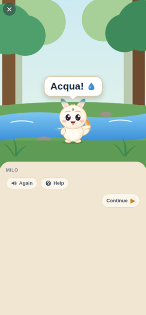
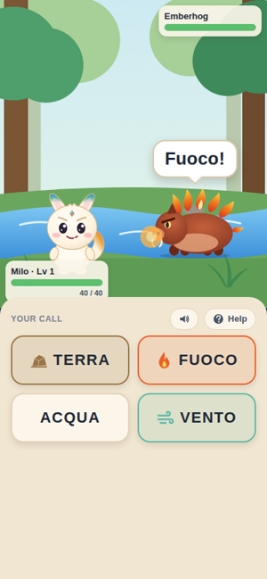
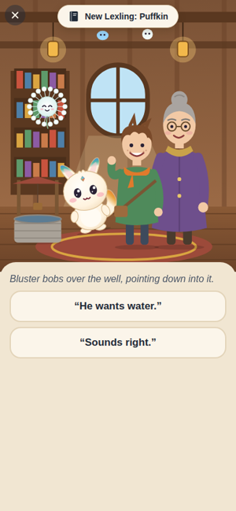
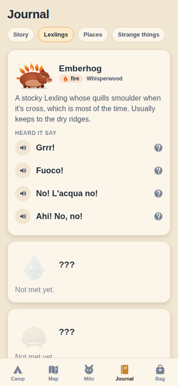

# Lexbound

An offline creature-companion RPG. In **Lexora**, humans speak English and the creatures, the **Lexlings**, speak their own language. You're a Translator-in-training, and your partner is **Milo**, a small Lexling nobody can identify who can somehow use every element. Understanding what he says is how you tell him what to do.

The Lexlings' language is real Italian. The game never says so; it just becomes the player's superpower.

<p>
  
  
  
  
</p>

## What's playable

The vertical slice from the bible (§75), on real engines:

1. **The Lodge.** Maren, a basket, a Lexling who says "Ciao!".
2. **Whisperwood.** Milo says "Guarda!" and points; "Vieni!" and runs ahead.
3. **The stream.** Milo splashes and says "Acqua!". No translation anywhere.
4. **The hot path.** Milo asks for "Acqua..."; the stick doesn't help, the flask does.
5. **The Emberhog.** It shouts "Fuoco!" and winds up. Four tiles: by now ACQUA has lost its icon, and the words you haven't learned still have theirs. Water douses its fire; fire heals it ("Mmm... grazie!"); wind fans it.
6. **After.** It looks at Milo and says something you can't follow yet. Milo retells the fight at camp. At the Lodge you understand Pip's Puffkin better than Pip does, and Maren learns what Milo can do.

Then Whisperwood keeps going: seven repeatable encounters picked by a scheduler that brings back the words you're starting to forget. Camp, map, Milo's page, a journal with a bestiary and remembered lines, a bag, accessibility settings and developer tools come with it.

## Run it

Node 22.

```bash
npm install
npm run app          # Expo dev server: press i / a for a simulator, or scan with Expo Go
npm run web          # in a browser
```

## Check it

```bash
npm run check        # typecheck, lint, copy lint, unit + content tests, sound files up to date
npm run e2e          # builds for web and plays the whole slice in Chromium
npm run screens      # the same, saving screenshots to ./screens
```

## Layout

| Folder | What |
| --- | --- |
| `packages/core` | The engines: language model, encounters, battles, scheduler, progression, save. Pure TypeScript, fully unit-tested. |
| `content` | The game as data: concepts, Italian lines, Lexlings, places, encounters. Its tests validate every reference and play the slice. |
| `app` | The Expo app. Art is drawn in code (`app/src/art`). |
| `e2e` | Playwright: plays the slice in a browser build. |
| `docs` | `game-bible.md` (the vision), `decisions.md` (how it was built and what changed), `content-guide.md` (writing encounters). |

## Not yet

Command composition ("ATTACCA + CON + ACQUA", bible Phase 9), more regions, recorded voices (creature lines use the device's Italian text-to-speech for now), and a native Italian speaker's review of every line. See `docs/decisions.md`.
